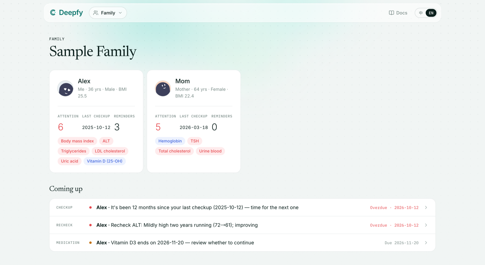

<div align="center">

<h1><a href="https://deepfy.si"></a>&nbsp;Deepfy Health</h1>

### Built for your health. Read by your agents.

**Checkups, lab results, medications and daily readings, in one structured record for your whole family.**<br>
See trends, keep track of rechecks, and get email reminders before they're due.<br>
Over MCP, your own agent can read the record and, with your OK, update it for you.

[](https://github.com/kuzicode/deepfy-health/releases) [](https://github.com/kuzicode/deepfy-health/stargazers) [](LICENSE) <br>
   

**[Website](https://deepfy.si)** &nbsp;·&nbsp; **[Docs](https://deepfy.si/en/docs)** &nbsp;·&nbsp; **[Releases](https://github.com/kuzicode/deepfy-health/releases)** &nbsp;·&nbsp; **[Roadmap](docs/ROADMAP.md)** &nbsp;·&nbsp; **[Contributing](.github/CONTRIBUTING.md)** &nbsp;·&nbsp; **[简体中文](docs/README.zh-CN.md)**

<br>



<sub>All data shown is fictional.</sub>

</div>

<br>

> [!IMPORTANT]
> **Pre-release software under active development.** Features, APIs and data formats may change.
>
> Deepfy Health is for reference only and doesn't replace medical advice. **Never post real health information in issues, pull requests or screenshots.**

## Is Deepfy Health for you?

Health records end up scattered across PDFs, photos and hospital apps, and an AI agent can't make sense of a file it has never seen. Deepfy Health turns them into one structured record that you and your agent can both use.

- **Keep the whole family in one place**: a profile, results and trends, medications and supplements for each person.
- **Hand a report to your agent**: it reads the report and enters the results. Every change is recorded, and you can undo it.
- **Know what's coming up**: overdue checkups, rechecks and supplement end dates appear on the overview and in email reminders.
- **Keep your data portable**: export your account at any time, and import it into your own instance.

Your health content is encrypted per account on the server. This isn't end-to-end encryption, and some lookup metadata, such as report dates and titles, isn't encrypted yet. See the [architecture notes](docs/architecture.md).

## Quick start

**Self-host it (recommended).** Run it on your own server and keep your data there. No domain or HTTPS needed: see [docs/self-hosting.md](docs/self-hosting.md). You're welcome to help build it too: see [Contributing](#contributing).

**Need it hosted?** The hosted app at **[app.deepfy.si](https://app.deepfy.si)** is an invite-only early bird program. Request access on the sign-in page, and you'll get an email once it's approved. It's free for now, with 100 MB of attachments per account.

**Connect your agent.** Create a token on the **Agents** page, then add the MCP server. For Claude Code on the hosted app (on your own instance, use its address):

```sh
claude mcp add --transport http deepfy https://app.deepfy.si/mcp \
  --header "Authorization: Bearer kzh_…"
```

The **Agents** page has ready-to-copy setups for other agents. New tokens can write by default. Choose **Read-only** when you create one, or change it later.

## Run it locally

You need Node 22 and pnpm. With no configuration, it runs on fictional sample data:

```sh
pnpm install
pnpm dev        # http://localhost:3000, reads examples/sample-vault
pnpm test
```

Sign-in, MCP and writes need a local Postgres (Docker):

```sh
cp .env.example .env.local   # uncomment the cloud mode lines and generate the two local keys
pnpm db:up && pnpm db:migrate
pnpm dev                     # without a mail provider, sign-in codes print to the console
```

To run the database tests:

```sh
docker compose -f compose.dev.yml exec db createdb -U kzh kzh_test
pnpm test:db
```

Local development needs no production accounts or keys.

## Two modes

- **Cloud mode** (`DATABASE_URL` is set): accounts sign in, and health content is encrypted per account in Postgres.
- **Local vault mode**: reads a folder of Markdown files directly, such as an Obsidian vault. This is mainly for development and backups.

To sync a local vault with an instance:

```sh
pnpm kzh login --server https://app.deepfy.si --token kzh_xxx
pnpm kzh push --dry-run      # preview what would be pushed
pnpm kzh push                # pushes only if validation passes; skips items newer in the cloud (--force overwrites)
pnpm kzh pull --into ./backup/Personal
```

Run `pnpm kzh --help` for all commands.

## Self-hosting

This is the recommended way to run Deepfy Health. The code ships with no user data, and you can import your account export from the hosted app. See [docs/self-hosting.md](docs/self-hosting.md) (in Chinese for now).

## Contributing

The best places to start are the indicator dictionary, data entry rules and translations. See [CONTRIBUTING.md](.github/CONTRIBUTING.md) and [AGENTS.md](AGENTS.md). To report a security issue, follow [SECURITY.md](.github/SECURITY.md) instead of opening a public issue.

## License

The code is under the [MIT License](LICENSE). The Deepfy name, logo and icons aren't covered by it; see [TRADEMARK.md](docs/TRADEMARK.md).

Release notes from before this repository was public are in [docs/release-history.md](docs/release-history.md).
