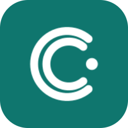
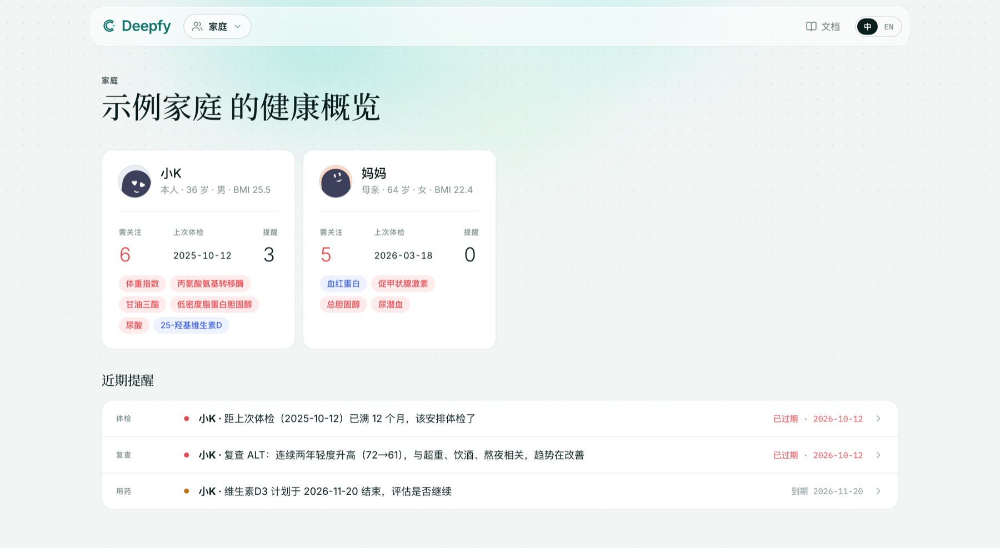

<div align="center">

<h1><a href="https://deepfy.si"></a>&nbsp;Deepfy</h1>

### Agent-first 的家庭知识库

在自己的服务器上整理健康档案、菜谱和保单，通过 MCP 接入你的 Agent，也能与本地 Obsidian 同步。

[](https://github.com/kuzicode/deepfy-family/releases) [](https://github.com/kuzicode/deepfy-family/stargazers) [](LICENSE) <br>
   

**[官网](https://deepfy.si)** &nbsp;·&nbsp; **[文档](https://deepfy.si/zh/docs)** &nbsp;·&nbsp; **[版本发布](https://github.com/kuzicode/deepfy-family/releases)** &nbsp;·&nbsp; **[路线图](docs/ROADMAP.md)** &nbsp;·&nbsp; **[参与贡献](.github/CONTRIBUTING.md)** &nbsp;·&nbsp; **[English](docs/README.en.md)**

<br>



<sub>图中数据均为虚构。</sub>

</div>

<br>

> [!IMPORTANT]
> **持续开发中的测试版，不是正式版本。** 功能、接口和数据格式都可能变化。
>
> 健康分析仅供参考，不能替代医生诊断。**不要在 Issue、PR 或截图里贴任何真实健康信息。**

## 适合你吗？

- **健康档案**　按成员查看检查结果、指标趋势、用药和补剂。把报告交给 Agent，它可以录入结果，修改有记录，也可以还原。
- **菜谱**　在 `/kitchen` 按菜名或食材找菜，也可以让 Agent 记录做法。选定成员后，可结合已有健康记录查看饮食适配提示。同步到 Obsidian 时，每道菜保存在 `Personal/菜单/` 的 Markdown 文件中。
- **保险**　在 `/insurance` 总览保单，按成员维护保险配置。续保日期会进入日程和提醒。
- **提醒**　在概览页查看体检、复查和补剂到期日。官方实例另提供可选的邮件提醒。
- **数据导出**　随时导出账号数据，再导入自己的实例。

健康档案、菜谱内容和附件在服务器上按账号加密。这不是端到端加密，报告日期和标题等检索用的元数据目前也还没有加密，详见[架构说明](docs/architecture.md)。

## 快速开始

在自己的电脑或服务器上安装 Git、OpenSSL 和 Docker（含 Compose v2），然后运行：

```sh
git clone https://github.com/kuzicode/deepfy-family.git && cd deepfy-family
sh scripts/selfhost-init.sh
docker compose up -d
```

构建完成后，在本机打开 `http://localhost:3100` 创建管理员账号。请单独备份初始化脚本生成的 `.env`，恢复加密数据需要其中的主密钥。NAS 局域网访问、云服务器 HTTPS 配置和定时备份见[自托管指南](docs/self-hosting.md)。

`app.deepfy.si` 是作者自用的在线实例，仅向亲友开放（白名单制）。对外推荐自托管。

### 接入 Agent

在「Agent 接入」页创建 Token，选择可访问的栏目（全部、仅健康或仅菜谱）。新 Token 默认可写入，只用于查询时可以选「只读」。例如，在部署 Deepfy 的电脑上使用 Claude Code，把示例 Token 换成刚创建的值：

```sh
claude mcp add --transport http deepfy http://localhost:3100/mcp \
  --header "Authorization: Bearer kzh_…"
```

其他 Agent 的配置可以在「Agent 接入」页复制。远程访问时，把本机地址换成自己的 HTTPS 域名。

## 本地运行

需要 Node 22 和 pnpm。什么都不配置，就能用虚构的样例数据跑起来：

```sh
pnpm install
pnpm dev        # http://localhost:3000，读 examples/sample-vault
pnpm test
```

要用登录、MCP 和写入，需要本地 Postgres（Docker）：

```sh
cp .env.example .env.local   # 取消注释云端模式那几行，并生成两个本地密钥
pnpm db:up && pnpm db:migrate
pnpm dev                     # 不配发信时，登录验证码打印在控制台
```

运行数据库测试：

```sh
docker compose -f compose.dev.yml exec db createdb -U kzh kzh_test
pnpm test:db
```

本地开发不需要任何线上账号或密钥。

## 两种模式

- **云端模式**（设置了 `DATABASE_URL`）：账号登录，档案和菜谱内容按账号加密后存进 Postgres。
- **本地 vault 模式**：直接读 Markdown 目录，可以是 Obsidian vault，主要用于开发和备份。

在「Agent 接入」页创建有「本地同步」权限且可访问全部栏目的 Token，用它把本地 vault 同步到自己的实例：

```sh
pnpm kzh login --server http://localhost:3100 --token kzh_xxx
pnpm kzh push --dry-run      # 先看会推多少
pnpm kzh push                # 校验通过才推；云端更新的条目默认跳过（--force 覆盖）
pnpm kzh pull --into ./backup/Personal
```

`pnpm kzh --help` 查看全部命令。

## 参与贡献

最适合入手的是指标字典、录入规则和多语言。先看 [CONTRIBUTING.md](.github/CONTRIBUTING.md) 和 [AGENTS.md](AGENTS.md)。安全问题请按 [SECURITY.md](.github/SECURITY.md) 私下报告，不要开公开 Issue。

## 许可证

代码使用 [MIT 许可证](LICENSE)。Deepfy 名称、logo 和图标不在其内，见 [TRADEMARK.md](docs/TRADEMARK.md)。

本仓库公开前的版本说明在 [docs/release-history.md](docs/release-history.md)。
