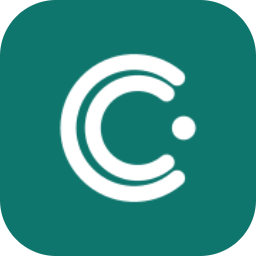
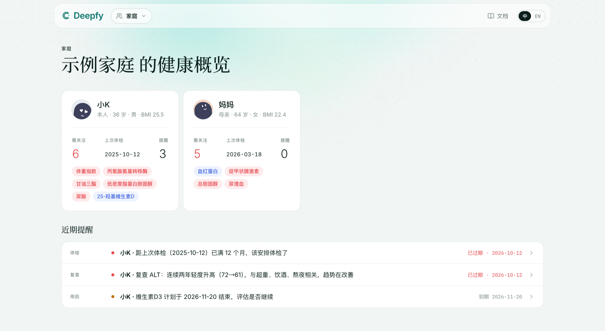

<div align="center">

<h1><a href="https://deepfy.si"></a>&nbsp;Deepfy Health</h1>

### 构建你的健康云档案，让 Agent 读懂你。

**体检、化验、用药和日常指标，整理成全家人的结构化健康档案。**<br>
看趋势、记复查，到期前收到邮件提醒。<br>
通过 MCP，你自己的 agent 可以读取档案，并在你同意后帮你更新。

[](https://github.com/kuzicode/deepfy-health/releases) [](https://github.com/kuzicode/deepfy-health/stargazers) [](LICENSE) <br>
   

**[官网](https://deepfy.si)** &nbsp;·&nbsp; **[文档](https://deepfy.si/zh/docs)** &nbsp;·&nbsp; **[版本发布](https://github.com/kuzicode/deepfy-health/releases)** &nbsp;·&nbsp; **[路线图](ROADMAP.md)** &nbsp;·&nbsp; **[参与贡献](CONTRIBUTING.md)** &nbsp;·&nbsp; **[English](README.md)**

<br>



<sub>图中数据均为虚构。</sub>

</div>

<br>

> [!IMPORTANT]
> **持续开发中的测试版，不是正式版本。** 功能、接口和数据格式都可能变化。
>
> Deepfy Health 仅供参考，不能替代医生诊断。**不要在 Issue、PR 或截图里贴任何真实健康信息。**

## 适合你吗？

健康资料往往散落在 PDF、照片和各家医院的 App 里，AI agent 也读不到它没见过的文件。Deepfy Health 把它们整理成一份结构化档案，你和你的 agent 都能用。

- **全家人放在一处**：每个人都有基本档案、检查结果和趋势、用药和补剂。
- **把报告交给 agent**：它读完报告，录入结果。每次修改都有记录，可以还原。
- **知道接下来要做什么**：逾期的体检、复查和补剂到期日会显示在概览页，也会发邮件提醒。
- **数据可以带走**：随时导出账号数据，再导入你自己部署的实例。

健康内容在服务器上按账号加密。这不是端到端加密，报告日期和标题等检索用的元数据目前也还没有加密，详见[架构说明](docs/architecture.md)。

## 快速开始

**自托管（推荐）。** 部署到自己的服务器，数据也留在那里，见 [docs/self-hosting.md](docs/self-hosting.md)。

**或者试用官方内测。** 在 **[app.deepfy.si](https://app.deepfy.si)** 注册。这是可选的内测服务，目前免费，每个账号 100 MB 附件。

**接入你的 agent。** 在「Agent 接入」页面创建 token，再添加 MCP 服务器。下面以 Claude Code 接入官方内测为例，自托管时换成自己的地址：

```sh
claude mcp add --transport http deepfy https://app.deepfy.si/mcp \
  --header "Authorization: Bearer kzh_…"
```

其他 agent 的配置可以在「Agent 接入」页面直接复制。新建 token 默认可写入。如果只想让 agent 读取，创建时选「只读」，之后也可以改。

## 本地运行

需要 Node 22 和 pnpm。什么都不配置，就能用虚构的样例数据跑起来：

```sh
pnpm install
pnpm dev        # http://localhost:3000，读 examples/sample-vault
pnpm test
```

要用登录、MCP 和写入，需要本地 Postgres（Docker）：

```sh
cp .env.example .env.local   # 取消注释云端模式那几行，并生成两个本地密钥
pnpm db:up && pnpm db:migrate
pnpm dev                     # 不配发信时，登录验证码打印在控制台
```

运行数据库测试：

```sh
docker compose -f compose.dev.yml exec db createdb -U kzh kzh_test
pnpm test:db
```

本地开发不需要任何线上账号或密钥。

## 两种模式

- **云端模式**（设置了 `DATABASE_URL`）：账号登录，健康内容按账号加密后存进 Postgres。
- **本地 vault 模式**：直接读 Markdown 目录，可以是 Obsidian vault，主要用于开发和备份。

把本地 vault 同步到实例：

```sh
pnpm kzh login --server https://app.deepfy.si --token kzh_xxx
pnpm kzh push --dry-run      # 先看会推多少
pnpm kzh push                # 校验通过才推；云端更新的条目默认跳过（--force 覆盖）
pnpm kzh pull --into ./backup/Personal
```

`pnpm kzh --help` 查看全部命令。

## 自托管

这是推荐的使用方式。代码不带任何用户数据，也可以导入从官方内测导出的账号数据，见 [docs/self-hosting.md](docs/self-hosting.md)。

## 参与贡献

最适合入手的是指标字典、录入规则和多语言。先看 [CONTRIBUTING.md](CONTRIBUTING.md) 和 [AGENTS.md](AGENTS.md)。安全问题请按 [SECURITY.md](SECURITY.md) 私下报告，不要开公开 Issue。

## 许可证

代码使用 [MIT 许可证](LICENSE)。Deepfy 名称、logo 和图标不在其内，见 [TRADEMARK.md](TRADEMARK.md)。

本仓库公开前的版本说明在 [docs/release-history.md](docs/release-history.md)。
