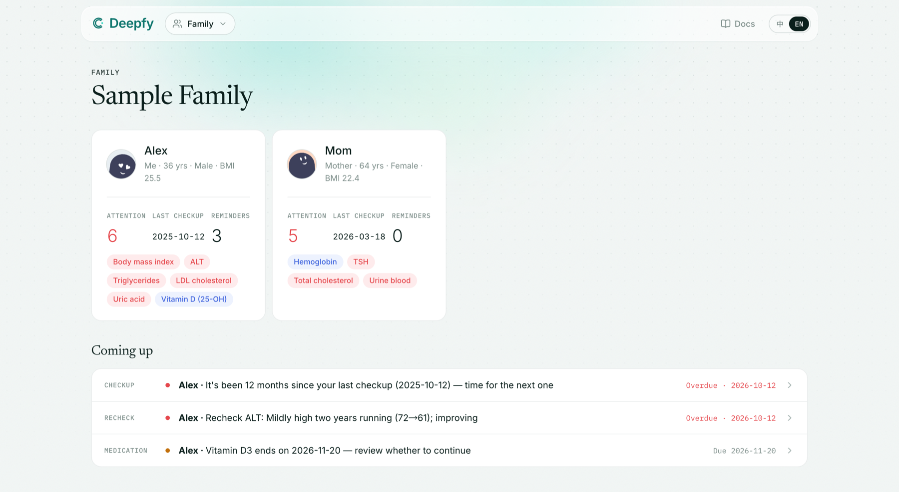

<div align="center">

<h1><a href="https://deepfy.si"></a>&nbsp;Deepfy</h1>

### An agent-first family knowledge base

Keep health records, recipes and insurance policies on your own server. Connect your agent over MCP or sync with a local Obsidian vault.

[](https://github.com/kuzicode/deepfy-family/releases) [](https://github.com/kuzicode/deepfy-family/stargazers) [](../LICENSE) <br>
   

**[Website](https://deepfy.si)** &nbsp;·&nbsp; **[Docs](https://deepfy.si/en/docs)** &nbsp;·&nbsp; **[Releases](https://github.com/kuzicode/deepfy-family/releases)** &nbsp;·&nbsp; **[Roadmap](ROADMAP.md)** &nbsp;·&nbsp; **[Contributing](../.github/CONTRIBUTING.md)** &nbsp;·&nbsp; **[简体中文](../README.md)**

<br>



<sub>All data shown is fictional.</sub>

</div>

<br>

> [!IMPORTANT]
> **Pre-release software under active development.** Features, APIs and data formats may change.
>
> Health analyses are for reference only and don’t replace medical advice. **Never post real health information in issues, pull requests or screenshots.**

## Is Deepfy for you?

- **Health records.** Track each person’s results, trends, medications and supplements. Your agent can enter results from a report, and you can review and undo its changes.
- **Recipes.** Search by dish or ingredient at `/kitchen`, or ask your agent to save a recipe. Select a person to see how a dish fits their recorded dietary needs. Each recipe syncs to a Markdown file in your vault’s `Personal/菜单/` folder.
- **Insurance.** Review policies together at `/insurance`, edit coverage by person and receive reminders when renewals are due.
- **Reminders.** See upcoming and overdue checkups, follow-ups and supplement end dates on the overview. Email reminders are also available on the official instance.
- **Data export.** Export your account at any time and import it into another instance.

Health records, recipe contents and attachments are encrypted per account on the server. This isn't end-to-end encryption, and some lookup metadata, such as report dates and titles, isn't encrypted yet. See the [architecture notes](architecture.md).

## Quick start

Install Git, OpenSSL and Docker with Compose v2 on your own computer or server, then run:

```sh
git clone https://github.com/kuzicode/deepfy-family.git && cd deepfy-family
sh scripts/selfhost-init.sh
docker compose up -d
```

Once the build finishes, open `http://localhost:3100` on that machine and create the administrator account. Back up the generated `.env` separately. You need its master key to restore encrypted data. For NAS access over a LAN, HTTPS on a cloud server and scheduled backups, see the [self-hosting guide](self-hosting.en.md).

The author’s instance at `app.deepfy.si` uses an allowlist for friends and family. We recommend running your own instance.

### Connect your agent

On the **Agents** page, create a token and choose the sections it can access (all sections, health records only or recipes only). Tokens allow writes by default. Choose **Read-only** if the agent only needs to look things up. To connect Claude Code on the machine running Deepfy, replace the example token with yours:

```sh
claude mcp add --transport http deepfy http://localhost:3100/mcp \
  --header "Authorization: Bearer kzh_…"
```

For other agents, copy the configuration from the **Agents** page. For a remote connection, replace the local address with your own HTTPS domain.

## Run it locally

You need Node 22 and pnpm. With no configuration, it runs on fictional sample data:

```sh
pnpm install
pnpm dev        # http://localhost:3000, reads examples/sample-vault
pnpm test
```

Sign-in, MCP and writes need a local Postgres (Docker):

```sh
cp .env.example .env.local   # uncomment the cloud mode lines and generate the two local keys
pnpm db:up && pnpm db:migrate
pnpm dev                     # without a mail provider, sign-in codes print to the console
```

To run the database tests:

```sh
docker compose -f compose.dev.yml exec db createdb -U kzh kzh_test
pnpm test:db
```

Local development needs no production accounts or keys.

## Two modes

- **Cloud mode** (`DATABASE_URL` is set): accounts sign in, and records and recipe contents are encrypted per account in Postgres.
- **Local vault mode**: reads a folder of Markdown files directly, such as an Obsidian vault. This is mainly for development and backups.

On the **Agents** page, create a token with **Local sync** permission and access to all sections. Use it to sync a local vault with your instance:

```sh
pnpm kzh login --server http://localhost:3100 --token kzh_xxx
pnpm kzh push --dry-run      # preview what would be pushed
pnpm kzh push                # pushes only if validation passes; skips items newer in the cloud (--force overwrites)
pnpm kzh pull --into ./backup/Personal
```

Run `pnpm kzh --help` for all commands.

## Contributing

The best places to start are the indicator dictionary, data entry rules and translations. See [CONTRIBUTING.md](../.github/CONTRIBUTING.md) and [AGENTS.md](../AGENTS.md). To report a security issue, follow [SECURITY.md](../.github/SECURITY.md) instead of opening a public issue.

## License

The code is under the [MIT License](../LICENSE). The Deepfy name, logo and icons aren't covered by it; see [TRADEMARK.md](TRADEMARK.md).

Release notes from before this repository was public are in [docs/release-history.md](release-history.md).
